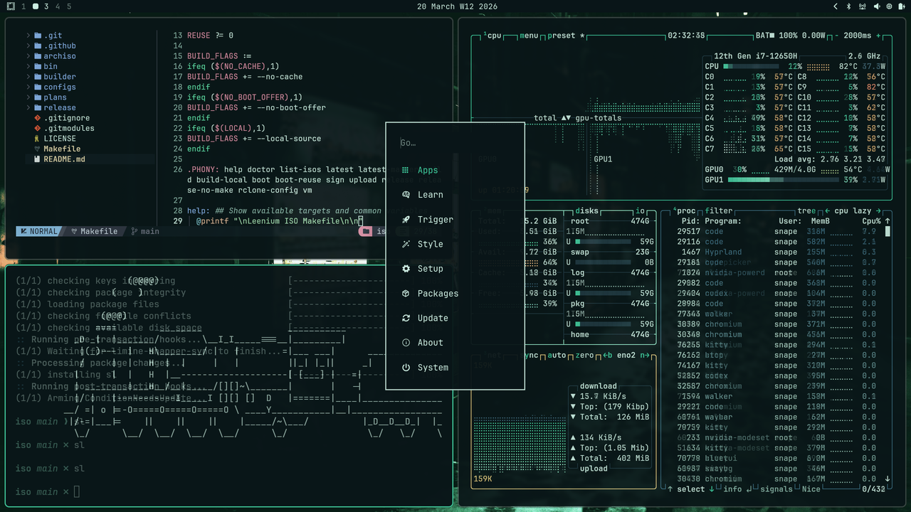
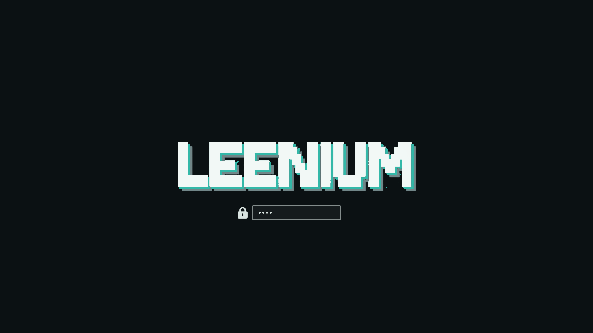

<div align="center">


**A dark Omarchy theme built from the shared Leenium palette.**

Hosted under `github.com/drunkleen/leenium.omarchy`.




</div>

---

## Color Palette

| Role | Hex | Swatch |
|---|---|---|
| Background | `#0b1113` |  |
| Panel | `#11191c` |  |
| Popup | `#182326` |  |
| Line / Border | `#223033` |  |
| Active | `#304144` |  |
| Selection | `#365156` |  |
| Foreground | `#d8e3e0` |  |
| Muted | `#718688` |  |
| Accent (Teal) | `#33b8a8` |  |
| Cyan | `#59d6c5` |  |
| Emerald | `#4dba7a` |  |
| Sea Bright | `#67cf94` |  |
| Type | `#71e4d8` |  |
| Warn | `#d9c76b` |  |
| Warn Bright | `#efd45e` |  |
| Orange | `#f4a259` |  |
| Error | `#e16f73` |  |
| Error Soft | `#f08787` |  |
| Blue | `#5e9bff` |  |
| Void | `#020405` |  |
| Sidebar | `#0e1518` |  |
| Card | `#141e21` |  |
| Floating | `#1d2a2d` |  |

---

## What's Included

| File | Applies to |
|---|---|
| `colors.toml` | Omarchy palette and Hyprland window borders |
| `btop.theme` | btop system monitor |
| `chromium.theme` | Chromium / Chrome NTP accent |
| `vscode.json` | VS Code theme setting for local theme setups |
| `icons.theme` | Icon pack (`Yaru-olive`) |
| `backgrounds/` | Six wallpapers and a Wired Horizon intro |

### Backgrounds

Wired Horizon (`1-wired_horizon.png`) is the first bundled wallpaper.
Omarchy remembers the last wallpaper you used with each theme. When Wired
Horizon is selected and background intros and animations are enabled, Omarchy
can play `backgrounds/intros/1-wired_horizon.mp4` on a theme switch.

- `1-wired_horizon.png`
- `crowned.png`
- `japan_blood.png`
- `japan_crosswire.png`
- `japan_night.png.png`
- `night-hawks.png`

---

## Installation

```bash
omarchy theme install https://github.com/drunkleen/leenium.omarchy
```

Or manually clone into your Omarchy themes directory:

```bash
git clone https://github.com/drunkleen/leenium.omarchy \
  ~/.config/omarchy/themes/leenium.omarchy
omarchy theme set leenium.omarchy
```

---

## The Leenium Ecosystem

Leenium is a unified dark desktop environment built around the shared palette. Explore the full ecosystem at [leenium.drunkleen.com](https://leenium.drunkleen.com).


<p align="center">
    Copyright &copy; 2026-present <a href="https://github.com/drunkleen" target="_blank">LEENIUM</a>
</p>
<p align="center">
    <a href="https://github.com/drunkleen/leenium.webpage/blob/master/LICENSE">
        
    </a>
</p>
